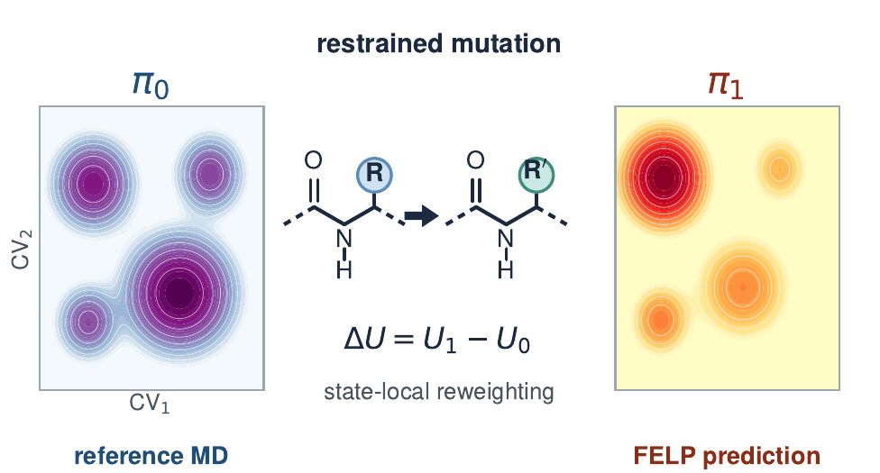

# FELP

Free Energy Landscape Perturbation estimates mutation-induced population shifts
from a reference MD ensemble. Given a trajectory and discrete conformational
states, FELP scores restrained reference and mutant structures, computes a local
perturbation factor in each state, and reweights the reference populations.

<p align="center">
  <a href="docs/figures/felp_toc_published.pdf"></a>
</p>

For reference probabilities $\pi_0(i)$ and state-local energy differences
$\Delta U$, the underlying estimator is

$$
\pi_1(i) =
\frac{\pi_0(i)\left\langle e^{-\beta\Delta U}\right\rangle_{0,i}}
{\sum_j\pi_0(j)\left\langle e^{-\beta\Delta U}\right\rangle_{0,j}}.
$$

The calculation predicts a population shift within the reference-sampled
landscape. It requires the reference to sample the conformations important to
the target. The [theory guide](docs/theory.md) derives this relation and explains
the approximations introduced by restrained endpoint scoring.

Paper: [Murdock and Brown, *J. Chem. Theory Comput.* (2026)](https://doi.org/10.1021/acs.jctc.6c01098).

## Install

Use Python 3.11. Run commands from the repository root.

```bash
git clone https://github.com/bpBrownLab/FELP.git
cd FELP
git submodule update --init ParmEd
python -m pip install -r scripts/requirements_postprocess.txt
python -m pip install PyYAML
```

Molecular scoring also needs OpenMM, MDTraj and a licensed PyRosetta installation.
FELP uses the bundled ParmEd for its Rosetta conversion support. Saved-score
analysis does not need the molecular-scoring dependencies. MSM fitting requires
PyEMMA.

The source-release tarball includes the modified ParmEd source, so it does not
need the submodule initialization step. Keep this copy of ParmEd: upstream
ParmEd does not provide the same Rosetta conversion support.

## Score, summarize and plot

This example mutates residue 2 from glycine to alanine on a 45 × 45 phi/psi grid.
Replace the input paths with your reference topology and trajectory.

```bash
python -m felp run \
  --topology-file reference.parm7 --trajectory reference.nc \
  --target-residue-number 2 --original-residue-name GLY --target-residue-name ALA \
  --phi-bins 45 --psi-bins 45 --restraint-force-constant 100000 \
  --prior-probability-mode raw_counts --temperature-kelvin 310 \
  --workers 4 --output-dir outputs/gly_to_ala

python -m felp summarize \
  --protocol jctc2026 \
  --raw-frame-results outputs/gly_to_ala/frame_results.csv \
  --phi-bins 45 --psi-bins 45 --prior-probability-mode raw_counts \
  --neighbor-pool-periodic-cvs phi psi --temperature-kelvin 310 \
  --output-dir outputs/gly_to_ala/summary

python -m felp felp-plot \
  --microstate-summary outputs/gly_to_ala/summary/microstate_summary.csv \
  --raw-frame-results outputs/gly_to_ala/frame_results.csv \
  --temperature-kelvin 310 --output-dir outputs/gly_to_ala/plots
```

`jctc2026` selects the paper's score filtering, PSIS and neighbor pooling settings.
It is a postprocessing preset; scoring restraints and mobility are set separately.
See the [manuscript protocol](docs/manuscript_protocol.md) for the settings used
for each system. U summarizes target mass supported by few effective samples;
H measures sensitivity to a smooth continuation into unvisited atlas cells.
Neither diagnostic certifies configuration-space overlap.

## More examples

### Multiple trajectories

Repeat `--trajectory` for independent simulations. Files within one flag are
consecutive segments of the same simulation:

```bash
--trajectory replica1.001.nc replica1.002.nc \
--trajectory replica2.001.nc replica2.002.nc
```

### File-defined states

A JSON or YAML atlas can define states using backbone angles, distances or custom
dihedrals. This example uses three illustrative Ramachandran basins:

```bash
python -m felp run \
  --topology-file reference.pdb --trajectory reference.dcd \
  --target-residue-number 2 --original-residue-name GLY --target-residue-name ALA \
  --microstate-source file --microstate-file examples/dipeptide_microstates.json \
  --prior-probability-mode raw_counts --allow-unassigned \
  --temperature-kelvin 310 --output-dir outputs/gly_to_ala_basins
```

These example basins do not cover the full Ramachandran domain.
`--allow-unassigned` excludes frames outside them, so the resulting probabilities
are conditional on the assigned region. Use a complete atlas for the paper's
grid analysis and harmonic exposure.

### MSM bundles

Fit an MSM with PyEMMA, then use its assignments and stationary probabilities:

```bash
python -m felp msm-fit \
  --topology-file reference.pdb \
  --trajectory reference.001.dcd reference.002.dcd \
  --feature-spec-file examples/msm_features_dipeptide.json \
  --k-clusters 50 --msm-lag 5 --write-plots \
  --output-dir outputs/reference.msm_bundle

python -m felp run \
  --topology-file reference.pdb \
  --trajectory reference.001.dcd reference.002.dcd \
  --target-residue-number 2 --original-residue-name GLY --target-residue-name ALA \
  --microstate-source msm_bundle --msm-bundle-dir outputs/reference.msm_bundle \
  --prior-probability-mode loaded --temperature-kelvin 310 \
  --output-dir outputs/gly_to_ala_msm
```

MSM states are an alternative to the regular atlases used in the paper. Harmonic
exposure requires a complete, uniform physical grid; it is unavailable for
general MSM clusters.

### Subsample before scoring

Add these options to `run` to score a reproducible subset within each state:

```bash
--microstate-sample-fraction 0.1 \
--microstate-min-samples 10 \
--microstate-sampling-seed 0
```

The initial assignment pass counts the reference frames before subsampling.
Keep `sampling_manifest.json` with the results so later analysis can recover
those counts.

## Commands and outputs

| Command | Purpose |
|---|---|
| `run` | Prepare, mutate and score reference frames |
| `summarize` | Reweight saved scores without repeating molecular scoring |
| `validate-microstates` | Check a JSON/YAML state atlas |
| `felp-plot` | Plot populations, free energies and weight diagnostics |
| `md-kl-plot` | Compare a FELP landscape with an independent MD ensemble |
| `composite-figure` | Arrange plot panels into a figure |
| `harmonic-exposure` | Calculate H and optional U from saved arrays |
| `msm-fit`, `msm-inspect`, `msm-plot`, `msm-export-samples` | Build, inspect and use MSM bundles |

`run` writes the per-frame scores in `frame_results.csv`, state populations and
ESS in `microstate_summary.csv`, and settings and diagnostics in JSON summaries.
`summarize` writes new summaries from those saved scores. Keep each summary
together with its `frame_weights.csv` for plotting. See
[usage](docs/usage.md#outputs) for the output files and
[plotting](docs/plotting.md) for figure options.

## Documentation

| Guide | Contents |
|---|---|
| [Theory](docs/theory.md) | Restricted partition functions, the estimator, scoring approximations and assumptions |
| [Usage](docs/usage.md) | Inputs, CVs, restraints, sampling and outputs |
| [Manuscript protocol](docs/manuscript_protocol.md) | Scoring settings, global tail cut, statewise PSIS and pooling |
| [Neighbor pooling](docs/neighbor_pool_reweighting.md) | Blend estimator, illustrated stencils and L-curve selection |
| [Diagnostics](docs/overlap_diagnostics.md) | What Pareto k, local ESS, U and H measure |
| [Harmonic exposure](docs/harmonic_exposure.md) | Dirichlet derivation, worked example and saved-array interface |
| [Plotting](docs/plotting.md) | State and frame-projected landscapes, units and display settings |
| [Benchmark reproduction](docs/reproduce_matrix.md) | The 67-system, six-treatment sensitivity matrix |

Run `python -m felp COMMAND --help` for all options. The `examples/` directory
contains microstate definitions, MSM commands and a small harmonic-exposure input.
The [source guide](felp/README.md) maps these calculations to their implementation.

## Tests and source archive

```bash
python -m pip install pytest
python -m pytest -q -m 'not integration'
python scripts/build_release.py --output-dir dist
```

Integration tests require the molecular-scoring dependencies. The source archive
includes code, tests, examples and documentation; simulation inputs are separate.
Energy tests also require OpenMM. See
[tests](tests/README.md) for the test layout and fixtures.
