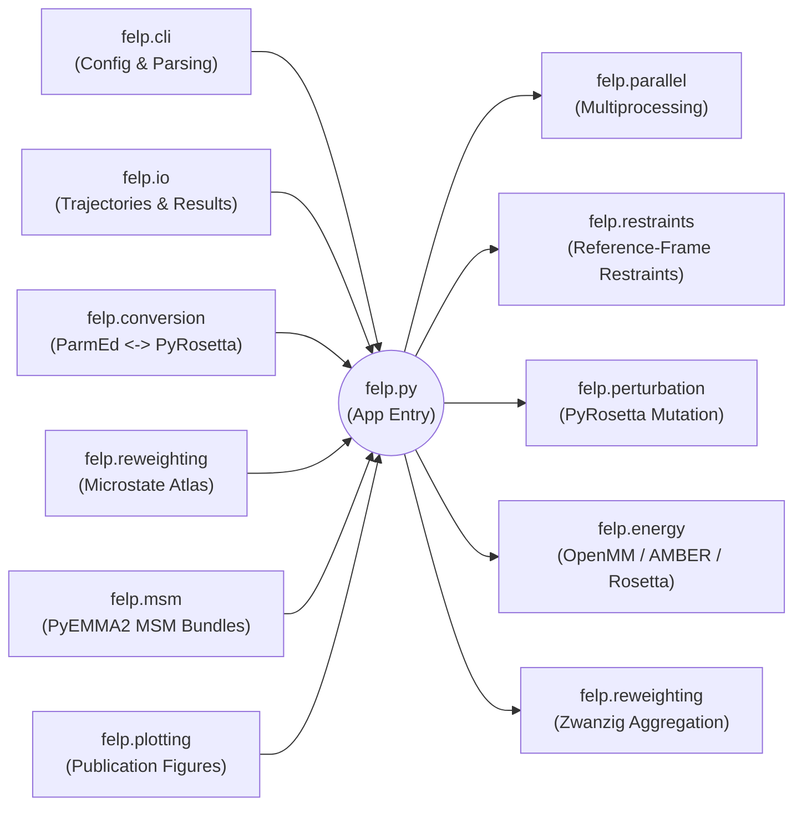

# FELP

Free Energy Landscape Perturbation for restrained, state-local reweighting.

FELP estimates how a local perturbation, such as a point mutation, reshapes a discrete free-energy landscape defined on a reference ensemble. It combines per-frame energy differences with microstate-resolved exponential reweighting to infer target-state populations and relative free energies.

## Overview

At a high level, FELP does five things:

1. Sample a reference ensemble from a trajectory.
2. Partition that ensemble into discrete microstates.
3. For each frame, evaluate the reference and perturbed systems under the same local restraints.
4. Compute a per-frame perturbation energy difference `delta_u = U_perturbed - U_reference`.
5. Aggregate those `delta_u` values within each microstate to reconstruct a reweighted target distribution.

This repository also supports MSM-backed FELP workflows. In that mode, a pre-fit PyEMMA bundle provides the discrete state definitions, assignments, and optionally a loaded reference prior.

## Theory

For overlap metrics, asymmetric support (GLY→ALA vs ALA→GLY), and which diagnostics detect pathology on sampled support, see [docs/overlap_diagnostics.md](docs/overlap_diagnostics.md).

### What FELP estimates

FELP is designed to answer a state-resolved question:

`If I start from a reference ensemble and apply a local perturbation, how do the occupancies and relative free energies of predefined states change?`

The method does not directly estimate a continuous global free-energy surface from scratch. Instead, it estimates a discrete target distribution over states and then projects that distribution back into convenient coordinates, such as Ramachandran phi/psi space, for visualization.

### Statistical-mechanics picture

Let `x` denote a configuration from the reference ensemble. FELP compares two effective potentials:

- `U_reference(x)`: the restrained reference-state energy.
- `U_perturbed(x)`: the restrained perturbed-state energy.

For each evaluated frame, FELP computes:

```text
delta_u(x) = U_perturbed(x) - U_reference(x)
beta = 1 / (k_B T)
```

The central object is the Boltzmann factor:

```text
exp(-beta * delta_u)
```

Within each microstate `i`, FELP uses the state-local mean of that factor to reweight the reference probability of the state into a target probability.

### Why FELP is state-local

The key approximation is that the perturbation can be estimated reliably by averaging within a discrete state rather than over the entire landscape at once. This is useful when:

- the reference trajectory already samples the important local substates;
- the perturbation is local enough that a frame remains meaningfully comparable to its reference microstate;
- the overlap problem is better behaved inside a state than across the whole ensemble.

In practice, the quality of the estimate depends strongly on whether each state has enough reference support and whether the perturbed and reference restrained ensembles overlap inside that state.

### Microstates

A microstate is a discrete state definition used for both assignment and aggregation. FELP supports three sources:

- `grid`: a uniform phi/psi grid over `[-180, 180)` on each axis.
- `file`: explicit JSON or YAML state definitions with `cv_ranges` and optional embedded `reference_probability`.
- `msm_bundle`: cluster or metastable states loaded from a previously exported PyEMMA bundle.

By default, FELP uses the backbone dihedrals `phi` and `psi` on the target residue as its collective variables. File-based microstates can generalize this to other named backbone dihedrals, but the current `grid` and `msm_bundle` modes require the default phi/psi pair.

Each frame is assigned to the first state whose angular intervals contain the measured CVs. Angular comparisons are circular, so wraparound intervals behave correctly across the `-180/180` boundary.

### Why restraints matter

FELP is a restrained comparison, not an unconstrained mutation free-energy calculation. For each frame, the code builds restraint targets from the reference geometry and applies the same restraint specification when evaluating the reference and perturbed states.

Conceptually, the restraints do two things:

- they keep the comparison local to the state represented by the frame;
- they reduce the chance that the perturbed structure relaxes into a qualitatively different basin before the energy comparison is made.

The practical consequence is important: FELP estimates the free-energy landscape of the restrained target ensemble induced by the chosen state definitions and restraint protocol. If the restraints are too weak, states can drift; if they are too strong, the restrained ensemble may be too artificial.

### Per-frame evaluation

For each trajectory frame, FELP performs the following conceptual steps:

1. Measure the reference-frame CVs and assign the frame to a microstate.
2. Build a set of restraints from that same reference geometry.
3. Construct the perturbed system from the reference structure.
4. Evaluate the reference and perturbed systems under the same restraints and the same energy backend.
5. Store the resulting `delta_u`.

The default energy backend is OpenMM with AMBER `ff14SBonlysc` and `GBNeck2` implicit solvent. Rosetta-based scoring is also supported. Regardless of backend, FELP compares like with like: same frame, same state definition, same restraint target, same temperature, different Hamiltonian only through the perturbation.

### Reference priors: `loaded` vs `raw_counts`

FELP needs a reference probability `pi_reference(i)` for each state `i`. The code supports two explicit modes:

- `loaded`: normalize the `reference_probability` values embedded in a microstate file or MSM bundle.
- `raw_counts`: estimate the reference prior empirically from the fraction of reweighting-eligible frames assigned to each state.

In plain text:

```text
pi_reference(i) = loaded prior from definitions, normalized            if mode = loaded
pi_reference(i) = eligible frame count in state i / total eligible    if mode = raw_counts
```

Use `loaded` when your state definitions already carry a trusted reference stationary distribution. Use `raw_counts` when you want FELP to use the evaluated trajectory itself as the reference prior.

Important implementation details:

- `grid` microstates do not embed probabilities, so they must use `--prior-probability-mode raw_counts`.
- a state with positive reference prior but zero evaluated frames is treated as unsupported and raises an error;
- failed frames and frames with non-finite energies are excluded from the reweighting estimate.
- when microstate-stratified evaluation sampling is active, `raw_counts` priors are computed from the full cheap-assigned trajectory support, while state-local `delta_u` averages are computed only from the selected evaluated frames.

### The state-local Zwanzig estimator

For state `i` with frames `j = 1..n_i`, FELP computes a numerically stabilized state-local Boltzmann average.

First define:

```text
delta_shift = min(delta_u over all eligible frames)
w_ij = exp(-beta * (delta_u_ij - delta_shift))
f_i = (1 / n_i) * sum_j w_ij
```

The shift `delta_shift` is only for numerical stability. It cancels during normalization and does not change the final target probabilities.

FELP then reconstructs the target distribution:

```text
Z = sum_i pi_reference(i) * f_i
pi_target(i) = pi_reference(i) * f_i / Z
```

This is the implementation-level estimator recorded in the run and plot summaries:

```text
pi_target(i) proportional to pi_reference(i) * <exp(-beta * delta_u)>_i
```

where the code evaluates the Boltzmann factor with the global stability shift described above.

### Microstate-stratified evaluation sampling

FELP can reduce expensive Rosetta/OpenMM work by evaluating only a random subset of frames within each assigned microstate:

```bash
python felp.py run ... \
  --microstate-sample-fraction 0.1 \
  --microstate-min-samples 10 \
  --microstate-sampling-seed 0
```

The default `--microstate-sample-fraction 1.0` evaluates every frame and preserves the historical behavior. When subsampling is enabled, FELP first assigns every frame to a microstate using a cheap assignment pass, writes `sampling_manifest.json`, and then evaluates only the selected frame indices. Resume runs reuse the manifest and fail if the current input or sampling configuration would produce a different selected set.

This is statistically valid because the state-local Zwanzig factor is still an unbiased uniform-within-state average of `exp(-beta * delta_u)`. The uncertainty, however, depends on the variance of the Boltzmann factors. Trust the per-state evaluated count and ESS diagnostics, not the raw selected count alone. For convergence checks, compare a cheap run against a larger fraction or the full `1.0` run on a smaller trajectory window.

### Sampling-density benchmark

Use `scripts/felp_sampling_benchmark.py` to generate a reproducible baseline plus sampling sweep and then analyze the finished outputs:

```bash
python scripts/felp_sampling_benchmark.py generate \
  --mutation ALA \
  --topology-file data/GLY/GLY.dry.parm7 \
  --trajectory '/home/murdocte/Projects/Rotation/GLY/GLY_prod.{0001..0250}.nc' \
  --output-root data/GLY/felp_sampling_benchmark_ALA \
  --analysis-dir data/GLY/felp_sampling_benchmark_ALA/analysis \
  --script-out data/GLY/felp_sampling_benchmark_ALA/run_sampling_benchmark.sh \
  --fractions 1.0 0.5 0.25 0.1 0.05 0.02 0.01 \
  --min-samples 10 \
  --seed 0

bash data/GLY/felp_sampling_benchmark_ALA/run_sampling_benchmark.sh
```

The generated shell script runs the full `1.0` baseline first, then the requested sampling fractions with identical topology, trajectory, bins, restraints, and random seed. After the runs finish, it writes `sampling_density_metrics.csv` and `sampling_density_convergence.{png,pdf,svg}` under the analysis directory. The figure tracks target-probability L1 error against the full baseline, maximum relative-free-energy error, global ESS fraction, and target mass in states with ESS below 10.

### Relative free energies

Once FELP has `pi_target(i)`, it converts target probabilities into relative free energies:

```text
F_i = -k_B T ln(pi_target(i))
```

Finite free energies are then shifted so that the minimum finite value is zero. Therefore:

- FELP free energies are relative, not absolute;
- only differences between states are meaningful;
- the zero of energy is chosen by the lowest finite target free energy in the computed set.

### Diagnostics carried per state

For each microstate, FELP also stores quantities that help interpret estimator quality:

- `frame_count`
- `reweight_factor = f_i`
- `effective_sample_size`
- `mean_delta_u_kj_mol`
- `std_delta_u_kj_mol`
- `mean_boltzmann_factor`
- `std_boltzmann_factor`

The effective sample size is computed from the state-local weights:

```text
ESS_i = (sum_j w_ij)^2 / sum_j (w_ij^2)
```

Low ESS is a warning sign that a state is dominated by a small number of very favorable frames.

### Phase-space support and overlap diagnostics

FELP estimates `pi_target` only on the **reference-sampled support** (bins or MSM states where the reference trajectory was assigned and evaluated). Target-only conformations outside that support are **not** assigned low overlap — they are **absent** (`pi_target = 0` with `raw_counts` priors on empty grid cells). See [docs/overlap_diagnostics.md](docs/overlap_diagnostics.md) for the full metric guide.

#### Hopeful vs pathological directions

For mutation scans such as GLY/PRO/ALA → X, the intended regime is **broad reference → narrower target** (e.g. **GLY → ALA**): the reference visits many φ/ψ bins; the target landscape concentrates on a subset. That can make **symmetric** metrics look poor even when the run is fine:

- **Low overlap coefficient Ω** — target distribution is a subset of the reference distribution.
- **Low global ESS fraction** — target weights are concentrated globally, not spread across all frames.

The **pathology** to detect is the opposite direction (e.g. **ALA → GLY**): a **narrow** reference cannot represent much of the target ensemble. Missing GLY basins are silent in FELP; the failure mode on sampled support is **unreliable local reweighting** where `pi_target` is large.

Ask: *On the states we actually occupy, is local reweighting trustworthy?* — not *Is the target as wide as the reference?*

#### Why ESS cutoffs 10 and 50?

`target_probability_low_ess_mass_ess_lt_10` and `_ess_lt_50` report the fraction of `pi_target` in states with **absolute** Kish ESS below 10 or 50. These are **nominal advisory flags** (common IS rules of thumb), not derived optima. They are comparable across runs but harsh on small-`n` states and lenient on large-`n` states.

A more scale-aware summary is **`target_probability_unreliable_local_support`**: sum of `pi_target` over states with

```text
ESS_i < max(min_state_ess, 0.1 * n_i)
```

using `min_state_ess` from reweighting QC (default 5). Prefer this when interpreting pathology.

#### Best metrics for ALA → GLY-style failure

| Priority | Metric | Interpretation |
|----------|--------|----------------|
| 1 | `target_probability_low_ess_mass_ess_lt_10` or `target_probability_unreliable_local_support` | **Lower is better.** High = most of the claimed target landscape sits in states with degenerate local weights. |
| 2 | `overlap_assessment` + `overlap_assessment_reasons` | Trust **low-ESS mass** reasons; treat **global ESS fraction** alone as often benign subset effect. |
| 3 | Per-state `effective_sample_size` and `target_probability` in `microstate_summary.csv` | Inspect states that matter. |
| 4 | `max_normalized_weight` | **Lower is better** — global weight degeneracy. |
| — | `overlap_coefficient` | **Higher is better** but ambiguous for subset targets; weak ALA→GLY detector. |
| — | Global ESS fraction | **Higher is better** but **misleading** for GLY→ALA-like subset cases. |

Use **bidirectional runs** (broad reference forward, narrow reference reverse) and **reference occupancy** of the state partition when coverage gaps matter.

### Spatially coupled reweighting backends

Beyond independent Zwanzig, `felp run` and `felp summarize` support optional backends that share the same per-state local factors but apply **grid-based spatial regularization** before computing `pi_target`:

| Backend | Purpose |
|---------|---------|
| `neighbor_pool` | ESS-weighted pooling of local Boltzmann factors toward CV-grid neighbors (recommended for noisy 2D bin maps) |
| `laplacian` | MAP on state excess free energies with a Laplacian prior between neighbors |
| `frame` | Global frame-level self-normalized importance sampling, then binning for summaries |

Enable one or more methods:

```bash
python felp.py summarize \
  --raw-frame-results path/to/frame_results.csv \
  --reweighting-methods independent neighbor_pool laplacian frame \
  --neighbor-pool-solver blend \
  --neighbor-pool-tau-mode lcurve \
  --laplacian-lambda 1.0 \
  ...
```

Each method is written under `reweighting_<method>/` with a shared `reweighting_comparison.json`.

**Neighbor-pool (default coupled method):** uses the **blend** solver and **L-curve** automatic τ selection unless `--neighbor-pool-tau` is set. τ is a pseudocount in ESS units (not frame count or grid size). See the dedicated references:

- [docs/neighbor_pool_reweighting.md](docs/neighbor_pool_reweighting.md) — blend vs variational, τ modes, metadata, workflow
- [docs/reweighting_methods.md](docs/reweighting_methods.md) — all backends and output layout

### Plotting semantics

FELP writes discrete state summaries first, then derives plots from those summaries.

For discrete state plots, the code uses the same `pi_reference(i)`, `pi_target(i)`, and `F_i` written to `microstate_summary.csv`.

For phi/psi frame-projected landscapes, FELP reweights individual subsampled frames using state-consistent weights:

```text
reference frame weight(i, j)  proportional to  pi_reference(i) / n_i
target frame weight(i, j)     proportional to  pi_reference(i) * exp(-beta * (delta_u_ij - delta_shift)) / n_i
```

Those weighted histograms are normalized to probability surfaces and converted to relative free energy with the same `-k_B T ln p` rule used for discrete states.

### Capped free-energy plots

`felp-plot` supports `--fel-max-energy-kj-mol` or `--fel-max-energy-kcal-mol` to cap the displayed color scale of free-energy plots. This is a plotting option only; it does not change the underlying probabilities or free energies.

When the cap is set:

- phi/psi free-energy heatmaps use `0 .. cap` on the colorbar;
- discrete microstate Ramachandran plots use the same cap;
- values above the cap are drawn in a flat background color instead of stretching the colormap;
- the `delta_free_energy_projection.png` plot uses a symmetric `-cap .. +cap` scale.

This is useful when a few very high-energy bins would otherwise compress the visually interesting low-energy region.

### MSM-backed FELP

An MSM bundle gives FELP a precomputed discrete state space. In practice that means:

- a bundle can define `cluster` or `metastable` states;
- the bundle can provide loaded reference probabilities for those states;
- frames can be assigned by precomputed discrete state IDs instead of geometric lookup.

The FELP reweighting step is still the same state-local exponential reweighting described above. The MSM bundle supplies the state definitions and, optionally, the reference prior. It does not change the form of the FELP estimator.

When using an MSM bundle, keep in mind that any loaded prior inherits the usual modeling choices made during MSM construction: features, lag time, clustering, state level, and the amount of data used to fit the model.

### What FELP is not

FELP is not a guarantee of globally converged free energies. The method can fail or become misleading when:

- the reference ensemble does not sample important perturbed conformations (target-only basins are **missing**, not flagged by Ω);
- a state has very poor overlap between reference and perturbed restrained ensembles on **sampled** support (see overlap diagnostics above);
- the chosen microstates are too coarse or mix multiple distinct basins;
- the restraints meaningfully distort the physics of the comparison;
- the energy model is not appropriate for the chemistry of interest.

Always inspect `overlap_assessment`, low-ESS / unreliable-support masses, `frame_count`, per-state `effective_sample_size`, and the plotted landscapes before drawing mechanistic conclusions.

## Implementation Overview

The codebase keeps `felp.py` as the top-level application entry point and organizes the workflow into a modular package:



### Module responsibilities

- `felp/cli/`: argument parsing and strongly typed configuration objects.
- `felp/conversion/`: interconversion between ParmEd structures, PyRosetta poses, and OpenMM topologies.
- `felp/restraints/`: reference-frame restraint builders for backbone-dihedral CVs.
- `felp/perturbation/`: perturbation construction and relaxation protocols.
- `felp/energy/`: pluggable energy evaluators; OpenMM/AMBER is the default backend.
- `felp/reweighting/`: microstate definitions, assignment policies, and state-local reweighting.
- `felp/parallel/`: multiprocessing workers and deterministic per-frame execution.
- `felp/io/`: trajectory loading and structured CSV/JSON output.
- `felp/msm/`: PyEMMA feature generation, clustering, MSM fitting, bundle export, and bundle-backed utilities.
- `felp/plotting/`: plotting helpers for MSM preprocessing and FELP postprocessing.

### Workflow

1. Load reference snapshots from one or more trajectories.
2. Assign each snapshot to a microstate.
3. Build restraints from the frame's reference geometry.
4. Construct and score the perturbed system against the same restrained reference context.
5. Aggregate per-frame `delta_u` values within each microstate.
6. Reconstruct the target state distribution and relative free energies.
7. Write tabular outputs and optional publication-style plots.

## Trajectory input convention

Trajectory-bearing commands use a repeatable grouped flag:

```bash
--trajectory simA.001.nc simA.002.nc simA.003.nc \
--trajectory simB.001.nc simB.002.nc
```

Files passed within one `--trajectory` flag are treated as contiguous chunks of the same simulation and concatenated in time. Repeating `--trajectory` starts a new independent trajectory. This matters most for MSM workflows, where trajectory independence should be preserved during estimation and bundle alignment.

## CLI

Show help:

```bash
python felp.py --help
```

Validate a microstate definition:

```bash
python felp.py validate-microstates \
  --microstate-source file \
  --microstate-file examples/dipeptide_microstates.json
```

Run a dipeptide-style benchmark with grid microstates:

```bash
python felp.py run \
  --topology-file data/reference.pdb \
  --trajectory data/reference.dcd \
  --target-residue-number 2 \
  --target-residue-name ALA \
  --output-dir outputs/gly_to_ala \
  --phi-bins 12 \
  --psi-bins 12 \
  --prior-probability-mode raw_counts \
  --workers 4
```

OpenMM platform selection is controlled with mutually exclusive `--cpu` / `--gpu`
flags (or `--platform-name NAME` for expert use). Without either flag, OpenMM
auto-selects the fastest available platform (typically CUDA). `--gpu` forces an
OpenMM GPU platform (CUDA first, then OpenCL), and `--cpu` forces the OpenMM CPU
platform.

When the OpenMM CPU platform is in use, FELP caps OpenMM's per-context thread
count at 1 by default (via `platformProperties={"Threads": "1"}` and the
`OPENMM_CPU_THREADS` environment variable), because the CPU platform will
otherwise try to fan out each tiny per-frame minimization across every logical
core on the host. On many-core servers that routinely produces NaN coordinates
during minimization, in addition to heavy oversubscription when stacked on top
of `--workers`. Increase it with `--cpu-threads N` only if you are running very
few workers and want OpenMM CPU to use intra-simulation threading.

```bash
python felp.py run ... --cpu --workers 192                 # 192 workers * 1 OpenMM thread
python felp.py run ... --cpu --workers 8 --cpu-threads 4   # 8 workers * 4 OpenMM threads
```

Run the same workflow with explicit microstate definitions and loaded priors:

```bash
python felp.py run \
  --topology-file data/reference.pdb \
  --trajectory data/reference.dcd \
  --target-residue-number 2 \
  --target-residue-name ALA \
  --microstate-source file \
  --microstate-file examples/dipeptide_microstates.json \
  --prior-probability-mode loaded \
  --output-dir outputs/gly_to_ala_explicit
```

For protein mutations, the default mobility policy is conservative: only the
target residue sidechain is mobile, while the backbone remains fixed. To allow a
local shell to co-relax, opt into radius mobility and, if needed, backbone motion:

```bash
python felp.py run \
  --topology-file data/kras_reference.pdb \
  --trajectory data/kras_reference.dcd \
  --target-residue-number 61 \
  --target-residue-name LEU \
  --microstate-source file \
  --microstate-file examples/kras_projected_states.json \
  --mobility-mode radius \
  --mobility-radius-angstrom 8.0 \
  --mobility-include-backbone \
  --output-dir outputs/kras_q61l_radius
```

Distance CV restraints can be added alongside the legacy target phi/psi
restraints. Declare each distance as `name:res1:atom1:res2:atom2` using the same
sequential pose residue numbering as `--target-residue-number`:

```bash
python felp.py run ... \
  --distance-cv q61_sw1:61:CA:35:CA \
  --distance-cv sw1_sw2:35:CA:71:CA
```

For arbitrary projected 2D CVs, start by composing primitive CVs such as these
distances in a file-based microstate definition rather than hard-coding a new
phi/psi-specific mode.

Recompute microstate summaries from an existing frame-results CSV:

```bash
python felp.py summarize \
  --raw-frame-results outputs/gly_to_ala/frame_results.csv \
  --microstate-source file \
  --microstate-file examples/dipeptide_microstates.json \
  --temperature-kelvin 300 \
  --output-dir outputs/gly_to_ala_resummarized
```

Fit a PyEMMA MSM bundle for later FELP runs:

```bash
python felp.py msm-fit \
  --topology-file data/reference.pdb \
  --trajectory data/reference.001.dcd data/reference.002.dcd \
  --trajectory data/replicate_b.001.dcd data/replicate_b.002.dcd \
  --feature-spec-file examples/msm_features_dipeptide.json \
  --output-dir outputs/dipeptide_bundle.msm_bundle \
  --reducer tica \
  --clustering-method kmeans \
  --k-clusters 50 \
  --msm-lag 5 \
  --metastable-states 3 \
  --write-plots
```

Inspect an exported bundle:

```bash
python felp.py msm-inspect --msm-bundle-dir outputs/dipeptide_bundle.msm_bundle
```

Run FELP from a precomputed MSM bundle:

```bash
python felp.py run \
  --topology-file data/reference.pdb \
  --trajectory data/reference.001.dcd data/reference.002.dcd \
  --trajectory data/replicate_b.001.dcd data/replicate_b.002.dcd \
  --target-residue-number 2 \
  --target-residue-name ALA \
  --microstate-source msm_bundle \
  --msm-bundle-dir outputs/dipeptide_bundle.msm_bundle \
  --state-level cluster \
  --prior-probability-mode loaded \
  --output-dir outputs/gly_to_ala_from_bundle
```

Export representative structures for bundle states:

```bash
python felp.py msm-export-samples \
  --msm-bundle-dir outputs/dipeptide_bundle.msm_bundle \
  --state-level metastable \
  --samples-per-state 20 \
  --output-dir outputs/dipeptide_bundle_samples
```

Generate publication-style plots directly from a bundle:

```bash
python felp.py msm-plot \
  --msm-bundle-dir outputs/dipeptide_bundle.msm_bundle \
  --state-level cluster \
  --output-dir outputs/dipeptide_bundle_plots
```

Generate publication-style plots from FELP outputs, with an optional free-energy cap:

```bash
python felp.py felp-plot \
  --microstate-summary outputs/gly_to_ala_from_bundle/microstate_summary.csv \
  --raw-frame-results outputs/gly_to_ala_from_bundle/frame_results.csv \
  --output-dir outputs/gly_to_ala_publication_plots \
  --temperature-kelvin 300 \
  --fel-max-energy-kj-mol 12
```

Generate a standalone probability-based KL comparison between an MD simulation and
a FELP reweighted surface:

```bash
python felp.py md-kl-plot \
  --felp-output-dir outputs/gly_to_ala_from_bundle \
  --raw-frame-results outputs/gly_to_ala_from_bundle/frame_results.csv \
  --topology-file reference.prmtop \
  --trajectory-file reference_md.nc \
  --phi-psi-residue-number 2 \
  --temperature-kelvin 300 \
  --fel-bins 180 \
  --fel-cmap gist_earth \
  --fel-max-energy-kj-mol 15 \
  --plot-energy-unit kcal_mol \
  --output-dir outputs/md_vs_reweighted_kl
```

Use the task-specific wrapper scripts if you prefer shorter entry points:

```bash
python scripts/msm_fit.py --help
python scripts/msm_plot.py --help
python scripts/felp_run.py --help
python scripts/felp_plot.py --help
```

Starter command templates are included in `examples/`:

- `examples/msm_fit_starter.sh`
- `examples/msm_plot_starter.sh`
- `examples/felp_run_from_bundle_starter.sh`
- `examples/felp_plot_starter.sh`

The `build_msm.py` script is a thin compatibility wrapper around `python felp.py msm-fit ...`.

## Outputs

### FELP run outputs

Each `run` workflow writes:

- `run_config.json`: the fully resolved FELP configuration.
- `sampling_manifest.json`: the full frame-to-microstate assignment map and deterministic selected frame indices used for expensive evaluation.
- `frame_results.csv`: one row per evaluated frame, including assignment, reference and perturbed energies, `delta_u`, relaxed CV measurements, status columns, and metadata.
- `microstate_summary.csv`: one row per microstate with `frame_count`, `reference_probability`, `reweight_factor`, `target_probability`, `free_energy_kj_mol`, `effective_sample_size`, summary statistics of `delta_u`, and metadata.
- `reweighted_surface.csv`: a plotting-friendly subset of the microstate summary containing coordinates, probabilities, and free energies.
- `run_summary.json`: a compact run summary with counts, probability totals, chosen prior mode, and the estimator string used to describe the reweighting.

Each `summarize` workflow writes:

- `microstate_summary.csv`: a recomputed state summary derived from an existing `frame_results.csv`.
- `reweighted_surface.csv`: the plotting-friendly surface view of the recomputed summary.
- `run_summary.json`: a concise summary of the recomputed aggregation.

Important semantics:

- `microstate_histogram` in `run_summary.json` is empirical frame counting, not the reweighted target distribution;
- `reference_probability` is the prior chosen by `loaded` or `raw_counts`;
- `target_probability` is the normalized reweighted state population;
- `free_energy_kj_mol` is derived from `target_probability` and shifted so the minimum finite value is zero.

To resume a previously interrupted run, add `--resume`. FELP will read `frame_results.csv` and only process the remaining frames.

### MSM bundle outputs

Each `msm-fit` bundle writes:

- `manifest.json`: bundle schema, state definitions, feature spec, and provenance.
- `assignments.npz`: per-trajectory discrete assignments and frame-source indices.
- `embedding.npz`: reduced trajectories and cluster centers for fast downstream visualization.
- `pyemma_checkpoints/`: optional native PyEMMA checkpoints when enabled.
- `plots/`: optional QC plots when `--write-plots` is enabled.

### Plot outputs

Each plotting command writes:

- `plot_summary.json` or command-specific `*_summary.json`: plot provenance plus divergence summaries where relevant.
- `*.png`: publication-style occupancy, divergence, projection, and free-energy figures.

For FELP plots, `plot_summary.json` records the current estimator descriptions and whether a free-energy display cap was applied via `fel_max_energy_kj_mol`.

## Testing

Run the lightweight test suite with:

```bash
python -m pytest -q
```

The dependency-heavy GLY->ALA end-to-end benchmark test runs automatically when PyRosetta and OpenMM are available.
