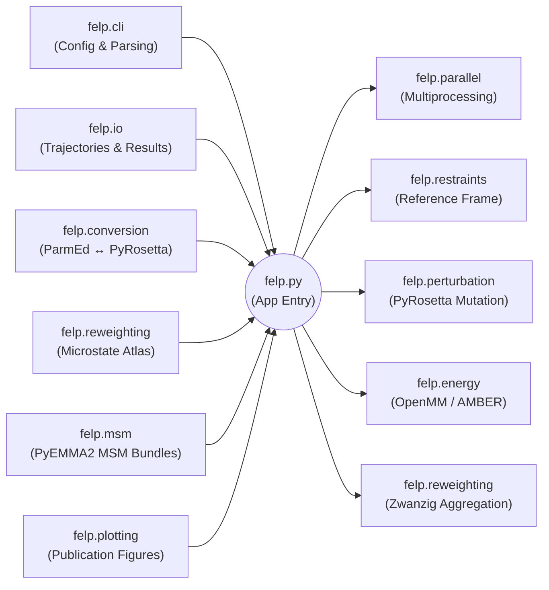

# FELP

Free Energy Landscape Perturbation for restrained state-local reweighting.

## Overview

The rewritten codebase keeps `felp.py` as the top-level application entry point and moves the workflow into a modular internal package:

### Code Organization (Fishbone Diagram)



### Module Responsibilities

- **`felp/cli/`**: Central argument parsing and strictly typed run configuration.
- **`felp/conversion/`**: Handles the complex interconversion between ParmEd Structures, PyRosetta Poses, and OpenMM Topologies.
- **`felp/restraints/`**: Shared-reference restraint builders to ensure perturbed states don't drift out of their defined microstate.
- **`felp/perturbation/`**: PyRosetta mutation and structural relaxation protocols.
- **`felp/energy/`**: Pluggable energy evaluators, with OpenMM/AMBER (`ff14SBonlysc` + `GBNeck2`) as the default backend.
- **`felp/reweighting/`**: Microstate definitions (grid or file-based) and local Zwanzig aggregation math.
- **`felp/parallel/`**: Worker initialization and deterministic frame execution using Python multiprocessing.
- **`felp/io/`**: Trajectory loading and structured results writing (CSV/JSON).
- **`felp/msm/`**: Modular PyEMMA2 feature generation, clustering, MSM/HMM fitting, QC plotting, bundle export, and bundle-backed sampling utilities.
- **`felp/plotting/`**: Publication-oriented plotting helpers for MSM preprocessing and FELP postprocessing.

### The Workflow

1. Load reference snapshots from a trajectory.
2. Assign each snapshot to a microstate.
3. Convert the snapshot into a PyRosetta pose.
4. Build restraints from the reference frame so the state definition is preserved.
5. Relax the reference pose and the perturbed pose under the same restraints.
6. Rescore both states with the selected energy backend.
7. Aggregate per-frame `deltaU` values within each microstate and reconstruct a reweighted landscape.

For MSM-FEP workflows, the project now also supports:

1. Featurizing trajectories with a declarative PyEMMA feature spec.
2. Fitting a reduced-space clustering plus discrete MSM, with optional metastable overlays.
3. Exporting a fast-loading MSM bundle that stores `dtrajs`, stationary probabilities, frame maps, and cached embeddings.
4. Running FELP directly from that precomputed bundle using cluster or metastable state assignments.

### Trajectory Input Convention

Trajectory-bearing commands now use a repeatable grouped flag:

```bash
--trajectory simA.001.nc simA.002.nc simA.003.nc \
--trajectory simB.001.nc simB.002.nc
```

Files passed within one `--trajectory` flag are treated as contiguous chunks of the same simulation and are concatenated in time. Repeating `--trajectory` starts a new independent trajectory, which is kept separate for MSM estimation and bundle alignment.

## CLI

Show help:

```bash
python felp.py --help
```

Validate a microstate definition:

```bash
python felp.py validate-microstates --microstate-file examples/dipeptide_microstates.json
```

Run a dipeptide-style benchmark with grid microstates:

```bash
python felp.py run \
  --topology-file data/reference.pdb \
  --trajectory data/reference.dcd \
  --target-residue-number 2 \
  --target-residue-name ALA \
  --output-dir outputs/gly_to_ala \
  --phi-bins 12 \
  --psi-bins 12 \
  --workers 4
```

Run the same workflow with explicit microstate definitions:

```bash
python felp.py run \
  --topology-file data/reference.pdb \
  --trajectory data/reference.dcd \
  --target-residue-number 2 \
  --target-residue-name ALA \
  --microstate-source file \
  --microstate-file examples/dipeptide_microstates.json \
  --output-dir outputs/gly_to_ala_explicit
```

Fit a PyEMMA MSM bundle for later FELP runs:

```bash
python felp.py msm-fit \
  --topology-file data/reference.pdb \
  --trajectory data/reference.001.dcd data/reference.002.dcd \
  --trajectory data/replicate_b.001.dcd data/replicate_b.002.dcd \
  --feature-spec-file examples/msm_features_dipeptide.json \
  --output-dir outputs/dipeptide_bundle.msm_bundle \
  --reducer tica \
  --clustering-method kmeans \
  --k-clusters 50 \
  --msm-lag 5 \
  --metastable-states 3 \
  --write-plots
```

Inspect an exported bundle:

```bash
python felp.py msm-inspect --msm-bundle-dir outputs/dipeptide_bundle.msm_bundle
```

Run FELP from a precomputed MSM bundle:

```bash
python felp.py run \
  --topology-file data/reference.pdb \
  --trajectory data/reference.001.dcd data/reference.002.dcd \
  --trajectory data/replicate_b.001.dcd data/replicate_b.002.dcd \
  --target-residue-number 2 \
  --target-residue-name ALA \
  --microstate-source msm_bundle \
  --msm-bundle-dir outputs/dipeptide_bundle.msm_bundle \
  --state-level cluster \
  --output-dir outputs/gly_to_ala_from_bundle
```

Export representative structures for bundle states:

```bash
python felp.py msm-export-samples \
  --msm-bundle-dir outputs/dipeptide_bundle.msm_bundle \
  --state-level metastable \
  --samples-per-state 20 \
  --output-dir outputs/dipeptide_bundle_samples
```

Generate publication-style plots directly from a bundle:

```bash
python felp.py msm-plot \
  --msm-bundle-dir outputs/dipeptide_bundle.msm_bundle \
  --state-level cluster \
  --output-dir outputs/dipeptide_bundle_plots
```

Generate publication-style plots from FELP outputs:

```bash
python felp.py felp-plot \
  --microstate-summary outputs/gly_to_ala_from_bundle/microstate_summary.csv \
  --raw-frame-results outputs/gly_to_ala_from_bundle/frame_results.csv \
  --output-dir outputs/gly_to_ala_publication_plots
```

Use the task-specific wrapper scripts if you prefer shorter entry points:

```bash
python scripts/msm_fit.py --help
python scripts/msm_plot.py --help
python scripts/felp_run.py --help
python scripts/felp_plot.py --help
```

Starter command templates are included in `examples/`:

- `examples/msm_fit_starter.sh`
- `examples/msm_plot_starter.sh`
- `examples/felp_run_from_bundle_starter.sh`
- `examples/felp_plot_starter.sh`

The `build_msm.py` script is now a thin compatibility wrapper around `python felp.py msm-fit ...`.

## Outputs

Each run writes:

- **`run_config.json`**: Fully resolved FELP configuration used for the run.
- **`frame_results.csv`**: Per-frame assignments, energies, and computed `deltaU`.
- **`microstate_summary.csv`**: Microstate-level statistics, effective sample sizes, and reweighting factors.
- **`reweighted_surface.csv`**: Projected microstate surface summary (probabilities and free energies).
- **`run_summary.json`**: Concise run summary including frame counts and output paths.

Each `msm-fit` bundle writes:

- **`manifest.json`**: Bundle schema, feature spec, reducer/clustering settings, state definitions, and provenance.
- **`assignments.npz`**: Per-trajectory `dtrajs`, frame-source indices, and optional metastable assignment arrays.
- **`embedding.npz`**: Reduced trajectories and cluster centers for fast downstream visualization.
- **`pyemma_checkpoints/`**: Optional native PyEMMA checkpoints when `--save-pyemma-checkpoints` is enabled.
- **`plots/`**: Optional QC plots when `--write-plots` is enabled.

Each plotting command writes:

- **`plot_summary.json`**: Plot provenance plus divergence summaries where relevant.
- **`*.png`**: Publication-style projection, occupancy, divergence, and free-energy figures.

To resume a previously interrupted run, simply add the `--resume` flag. FELP will read `frame_results.csv` and only process the remaining frames.

## Testing

Run the lightweight test suite with:

```bash
python -m pytest -q
```

The dependency-heavy GLY→ALA end-to-end benchmark test is included and will run automatically when PyRosetta and OpenMM are available.
