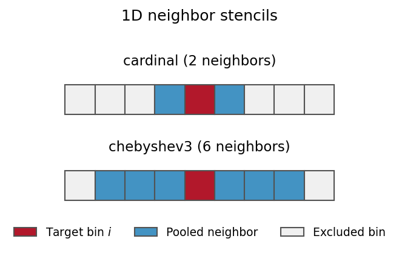
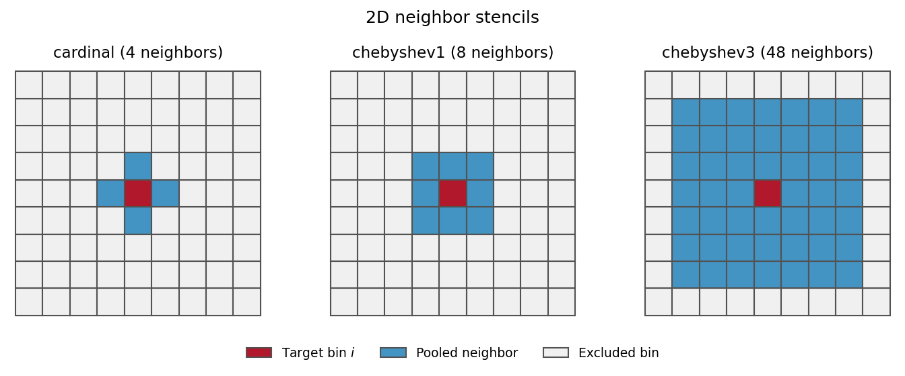

# Reweighting and diagnostics

This overview follows the main calculation. See [theory](theory.md) for the
partition-function derivation and scoring assumptions, and the
[manuscript protocol](manuscript_protocol.md) for reproducible settings.

## Scoring

FELP builds reference and mutant branches from each sampled configuration.
Rosetta prepares each branch under the same CV restraints; OpenMM then minimizes
and scores it. The default scoring model is ff14SBonlysc with GBNeck2 implicit
solvent. The score is `delta_u = U_mutant - U_reference` in kJ/mol.

These are locally minimized endpoints, not thermally sampled mutant ensembles.
A good reweighting diagnostic cannot establish that the scoring model is accurate.

## State populations

For each state, average `exp[-beta * (delta_u - s)]` to obtain a factor `f_i`.
Here `beta = 1/(k_B T)` and `s` is a common energy shift for numerical stability.
The target population is proportional to `p_reference(i) * f_i`.
Local weight ESS is `(sum(w))^2 / sum(w^2)`.

The `jctc2026` preset applies:

1. Keep the original reference counts for the prior.
2. Remove scores in ascending energy order until the retained weights first have
   a finite global Pareto `k < 0.5`, retaining at least 20 scores.
3. Apply ArviZ 0.22.0 PSIS within each state with `reff=1`, preserving the relative
   scale of the state factors.
4. Blend neighboring factors using local ESS and an L-curve choice of tau.
5. Normalize the populations and report U and H.

An excluded score still contributes to the original reference counts. A state can
lose all usable scores. If no cut passes, the original scores are retained with
unresolved QC. Constant identity weights also have an undefined tail fit.
A passing fit describes the retained weights, not the accuracy of discarded scores.

## Neighbor pooling

Let `f_bar_i` be the ESS-weighted mean of neighboring state factors. Pooling uses

```text
alpha_i = ESS_i / (ESS_i + tau)
f_blend_i = alpha_i * f_i + (1 - alpha_i) * f_bar_i
```

States with many effective samples retain more of their own estimate. If no
eligible neighbors exist, use the local factor. The L-curve selects tau by
balancing ESS-weighted log-factor misfit against graph roughness; its corner is
the point farthest from the line joining the ends of the log-log curve.

The paper uses Chebyshev radius 3 in 2D and cardinal neighbors in 1D. Periodic
axes must be supplied explicitly. The sensitivity matrix also uses fixed tau
values of 1 and 100.




The [pooling guide](neighbor_pool_reweighting.md) derives the blend and
L-curve objectives and explains the stencils and boundary conditions.

## U: probability supported by few effective samples

`U` is the sum of predicted populations in states with local treated-weight
`ESS < 10`. It uses the local ESS even after pooling. A large U means much of
the prediction depends on poorly sampled local factors.

## H: harmonic exposure

At every originally visited grid cell, fix an amplitude `a_i = sqrt(q_i)`, where
`q` is the final predicted population. This includes visited cells with `q_i=0`.
At unvisited cells, solve the discrete Dirichlet problem on the cardinal grid,
with edge weights `1 / axis_spacing^2` and the specified periodic boundaries.

```text
L_WW * a_W = -L_WV * a_V
E = sum(a_i^2 for i in unvisited_cells)
H = E / (1 + E)
```

H is the total-variation change caused by this smooth continuation. It is not an
estimate of the actual missing target population. It is zero when all grid cells
were visited, even if sampling within them is inadequate. Its cardinal graph is
separate from the graph used for pooling.

To calculate H from saved arrays:

```bash
python -m felp harmonic-exposure \
  --input examples/harmonic_exposure.json --output harmonic_result.json
```

The example returns H=0.2 and U=0.64. The input fields are:

| Field | Meaning |
|---|---|
| `schema_version` | 1 |
| `state_ids` | Unique labels in the full grid's C order |
| `state_counts` | Original counts, before score filtering |
| `q` | Normalized final probabilities in the same order |
| `grid_shape` | One or two axis lengths |
| `periodic` | Boolean wrapping flag for each axis |
| `steps` | Positive uniform axis spacings |
| `local_ess` | Optional local ESS values for U |

Include empty cells, with zero q. Preserve physical grid order; sorting labels
alone does not establish adjacency. An unavailable or irregular atlas produces
an unavailable H, not zero. The implementation checks the residual, fixed anchors
and maximum principle.

The graph construction follows Doyle and Snell, *Random Walks and Electric
Networks* (1984); Zhu, Ghahramani and Lafferty, ICML (2003), pp. 912–919; and
Grady, *IEEE TPAMI* (2006), DOI 10.1109/TPAMI.2006.233.

See [harmonic exposure](harmonic_exposure.md) for the full derivation and worked
example, and [diagnostics](overlap_diagnostics.md) for interpretation.
