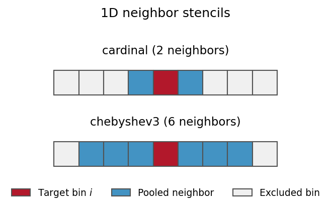
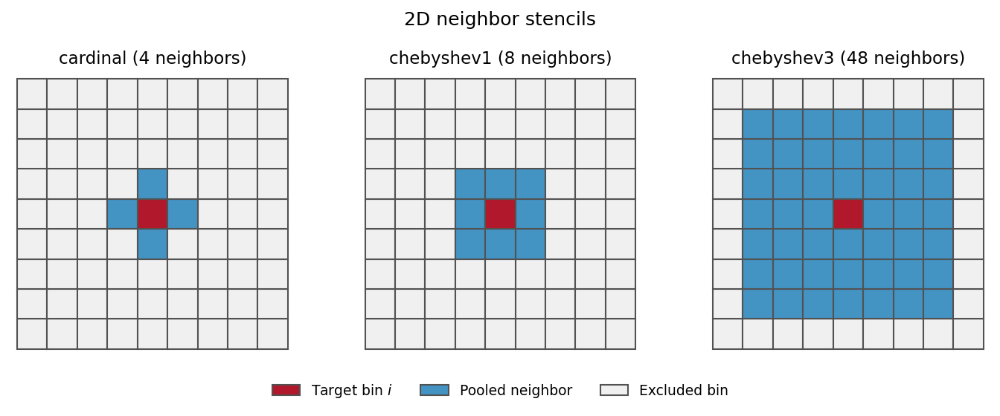

# Neighbor-pool reweighting

Neighbor pooling reduces noise in state-local perturbation factors by borrowing
information from nearby states. It assumes that those factors vary smoothly
over the chosen CV grid. The reference populations remain fixed.

The paper uses the blend estimator below, with an L-curve choice of smoothing
strength. The [manuscript protocol](manuscript_protocol.md) also specifies the
score filtering and PSIS steps that precede pooling.

## Independent state estimates

For evaluated frames in state $i$, the independent estimator computes

$$
w_{ij}=e^{-\beta(\Delta U_{ij}-s)},
\qquad
f_i=\frac{1}{n_i}\sum_j w_{ij},
\qquad
\hat\pi_1(i)=\frac{\hat\pi_0(i)f_i}{\sum_k\hat\pi_0(k)f_k}.
$$

Here $s$ is a global energy shift. Under the paper's protocol, $f_i$ uses the
statewise PSIS-treated weights after the global score cut. The independent
estimate provides a baseline for assessing how much pooling changes the result.

## ESS-weighted blending

For eligible neighbors $\mathcal N(i)$, define

$$
\bar f_i=
\frac{\sum_{j\in\mathcal N(i)}\mathrm{ESS}_j f_j}
{\sum_{j\in\mathcal N(i)}\mathrm{ESS}_j}.
$$

Only neighbors with positive local ESS and positive factors contribute. If
there are none, use $\bar f_i=f_i$. The blended factor is

$$
f_i^{\mathrm{blend}}=\alpha_i f_i+(1-\alpha_i)\bar f_i,
\qquad
\alpha_i=\frac{\mathrm{ESS}_i}{\mathrm{ESS}_i+\tau}.
$$

High-ESS states retain more of their local estimate. Low-ESS states borrow more
from neighbors. For example, at $\tau=10$, a state with ESS 90 retains 90% of
its local factor; a state with ESS 1 retains about 9%. There is no imposed
minimum local contribution in the manuscript protocol.

The final probability is

$$
\hat\pi_1(i)=
\frac{\hat\pi_0(i)f_i^{\mathrm{blend}}}
{\sum_k\hat\pi_0(k)f_k^{\mathrm{blend}}}.
$$

Pooling a factor into a cell with zero reference prior still gives zero target
probability. A visited cell that loses all its usable scores during global QC
can borrow a factor, but its local ESS remains zero. Pooling does not manufacture
effective observations or lower U by replacing local ESS with neighbor ESS.

## Choosing the smoothing strength

Increasing $\tau$ increases the contribution from neighbors. A fixed value is
useful for sensitivity comparisons; the paper compares $\tau=1$, $\tau=100$
and an automatically selected value.

For each candidate $\tau$, the L-curve calculation evaluates log-factor misfit

$$
\mathcal M(\tau)=\sum_i\mathrm{ESS}_i
\left[\ln f_i-\ln f_i^{\mathrm{blend}}(\tau)\right]^2
$$

and graph roughness

$$
\mathcal R(\tau)=\frac12\sum_i\sum_{j\in\mathcal N(i)}
\left[\ln f_i^{\mathrm{blend}}(\tau)-
\ln f_j^{\mathrm{blend}}(\tau)\right]^2.
$$

The sums use states with retained frames and positive factors. The scan uses
30 geometrically spaced values from 1 to
$\max(10\max_i\mathrm{ESS}_i,10)$. The selected corner is the point farthest
from the chord joining the two extremes of the log-log misfit–roughness curve.
This balances fidelity to the local estimates against smoothness; it does not
optimize agreement with a target trajectory.

To select it explicitly:

```bash
--reweighting-method neighbor_pool \
--neighbor-pool-solver blend --neighbor-pool-tau-mode lcurve
```

For a fixed strength:

```bash
--reweighting-method neighbor_pool --neighbor-pool-tau 100
```

## Grid topology

The figures show the target bin in red and its neighbors in blue. Counts below
refer to interior bins; boundaries and periodic wrapping affect the actual set.

### One dimension



Cardinal connectivity uses the two adjacent bins. Chebyshev radius 3 reaches
three bins in each direction, giving six neighbors.

### Two dimensions



Cardinal connectivity uses four edge-sharing bins. Chebyshev radius 1 includes
the diagonals, giving eight neighbors. Radius 3 uses the surrounding $7\times7$
block, excluding the target, for 48 neighbors. A broader stencil smooths over
a larger CV range and can cross a physical basin boundary.

The **publication-selected settings are Chebyshev radius 3 in 2D and cardinal
in 1D**. Generic neighbor pooling defaults to cardinal; `--protocol jctc2026`
selects the paper's graph from the atlas dimension. The
[sensitivity matrix](reproduce_matrix.md) compares both graph families.

```bash
--neighbor-pool-grid-connectivity chebyshev3
```

### Periodic axes

Specify wrapping using the CV labels in the atlas:

```bash
--neighbor-pool-periodic-cvs phi psi
```

For the protein atlases, use `psi_114` for T4L or `aloop` for EGFR. Distance
axes are nonperiodic. Only the requested axes wrap; names alone do not imply
periodicity. Wrapping requires a regular grid. A non-grid state model may use
the approximate k-nearest-neighbor topology, but it does not supply the regular
geometry needed for harmonic exposure.

The pooling graph and the harmonic-exposure graph serve different purposes.
H always uses cardinal grid edges, even when pooling uses Chebyshev radius 3.

## Reprocess saved scores

For the full manuscript protocol on a protein atlas:

```bash
python -m felp summarize \
  --protocol jctc2026 \
  --raw-frame-results outputs/mutant/frame_results.csv \
  --microstate-source file --microstate-file atlas.json \
  --prior-probability-mode raw_counts --temperature-kelvin 310 \
  --output-dir outputs/mutant/pooled
```

Add the periodic axes required by that atlas. To compare independent and pooled
estimates outside the preset, request both explicitly with
`--reweighting-methods independent neighbor_pool` and supply the same QC options.
For the paper's complete six-treatment comparison, use the matrix runner so
every graph receives exactly the same filtered and PSIS-treated input.

## Order of operations

Reference priors are fixed before the global cut. Statewise PSIS then provides
the factors and local ESS used by pooling. Pooling neither chooses the retained
frames nor resolves an unsuccessful tail fit. A smooth landscape can still
be inaccurate because of missing conformations or scoring-model error.

The implementation is in
[neighbor_pool.py](../felp/reweighting/engines/neighbor_pool.py), with graph
construction in [topology.py](../felp/reweighting/topology.py).
